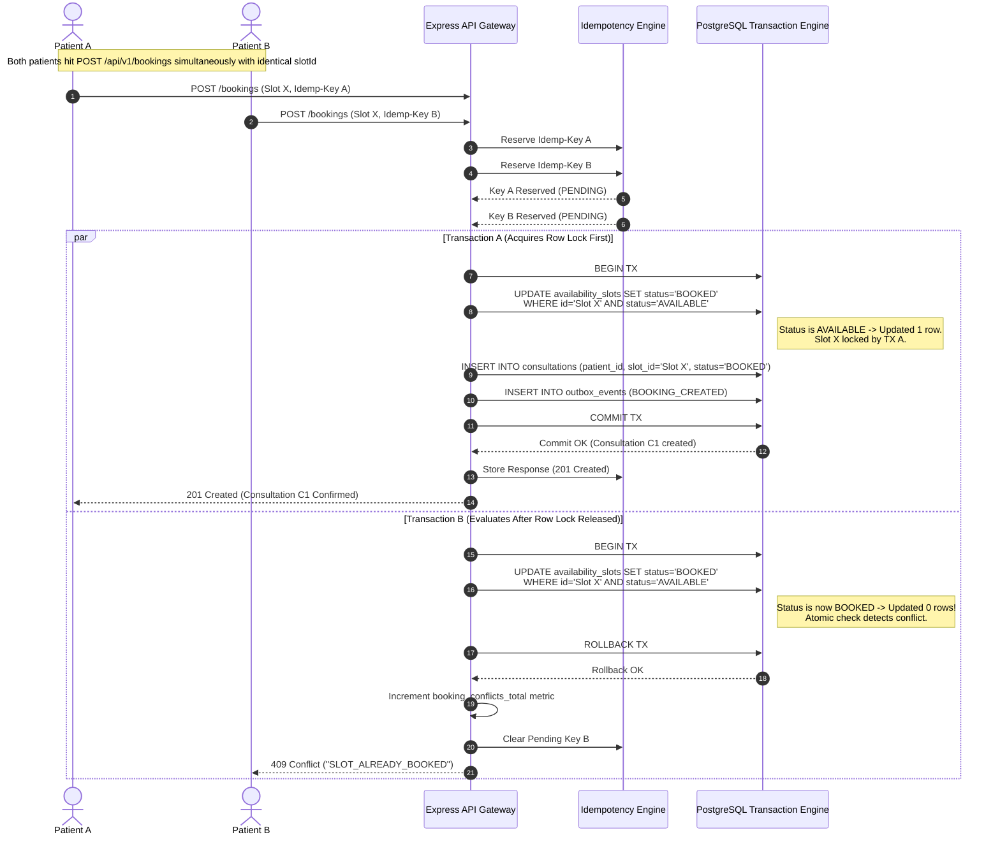
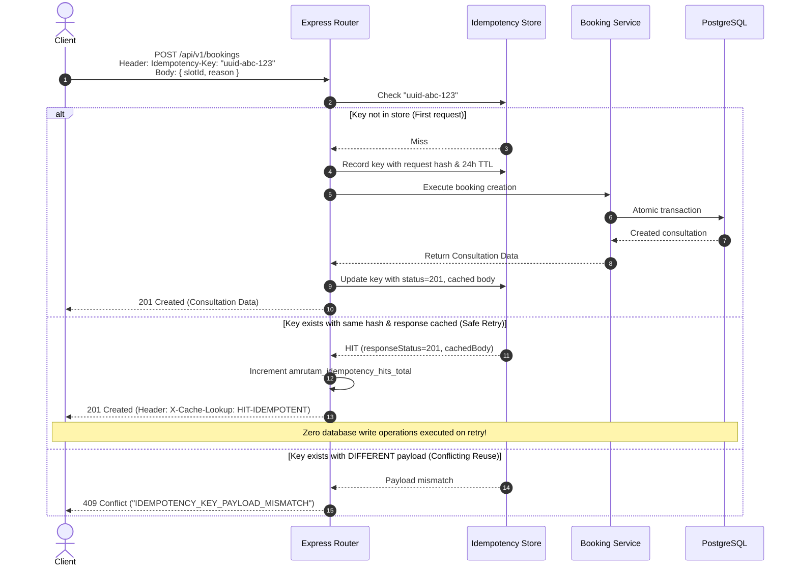
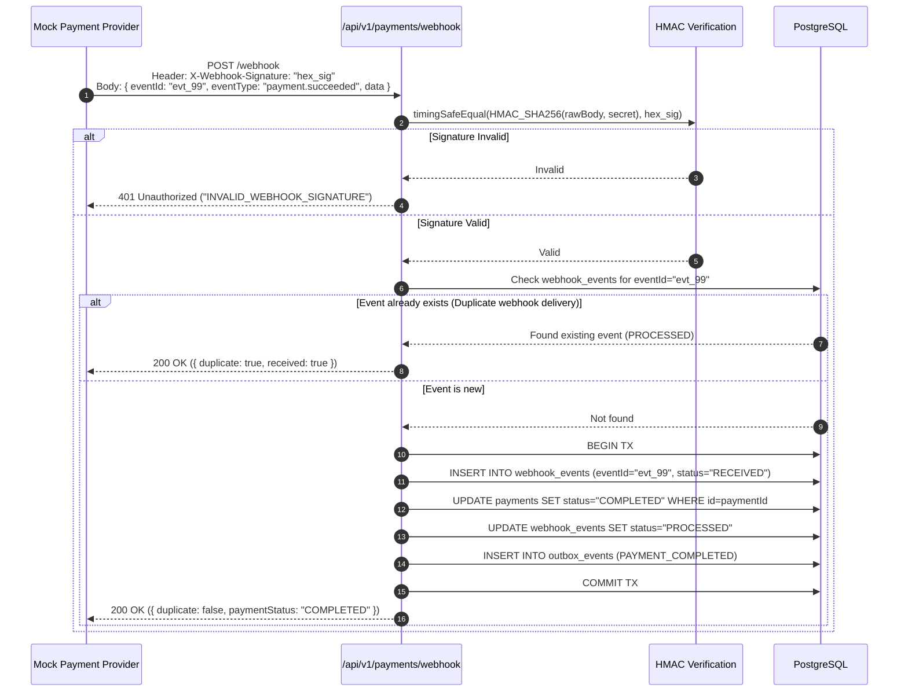

# Amrutam Telemedicine Booking Sequence Diagrams

This document details the exact sequence of interactions for critical workflows in the Amrutam Telemedicine platform, demonstrating race condition handling, idempotency deduplication, and payment webhook verification.

## 1. Concurrent Booking Flow (Simultaneous Attempts)

The diagram below shows how the platform prevents double bookings when two patients attempt to book the same slot at the exact same millisecond.

---

## 2. Idempotency Flow (Network Retries & Cached Responses)

This diagram details the client retry flow where network timeouts or duplicate submissions occur.

---

## 3. Verified Payment Webhook Flow

