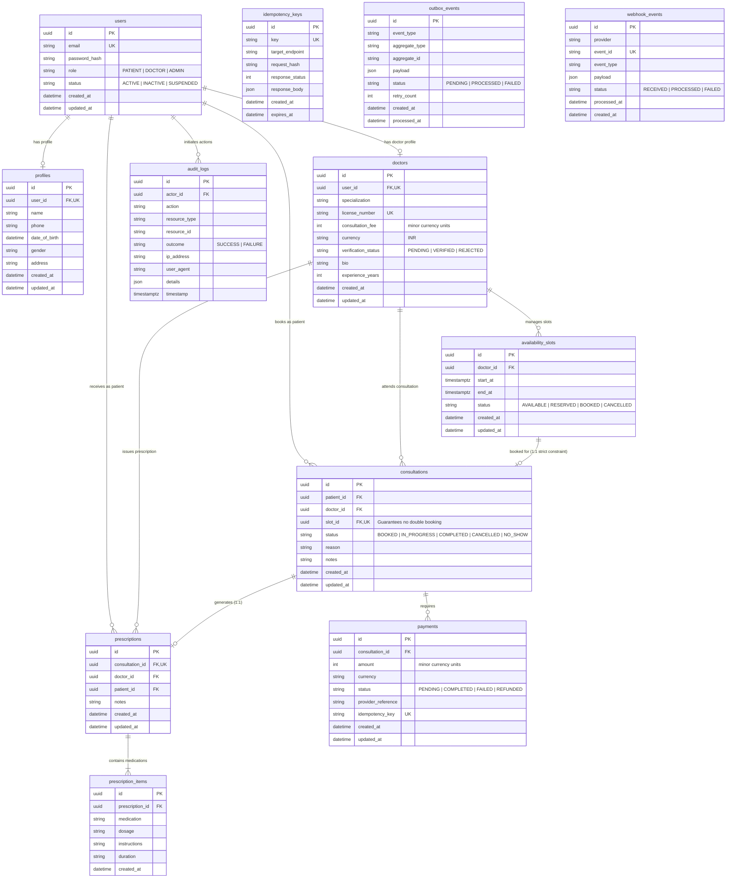

# Amrutam Telemedicine Database Entity-Relationship Diagram

This document illustrates the relational schema designed for Amrutam's Telemedicine Platform. It enforces data integrity, medical confidentiality, strict slot locking, and asynchronous audit trails.

## Key Database Design Principles

1. **Strict 1:1 Booking Constraint**:
   `consultations.slot_id` has a strict `@unique` database constraint and references `availability_slots.id`. This ensures that even in the case of application bugs, PostgreSQL will never allow two consultations to reference the same slot.
2. **Money in Minor Units**:
   Consultation fees and payment amounts are stored as integers representing minor currency units (e.g. 50,000 paise = ₹500.00), preventing floating-point rounding errors.
3. **Audit Trail**:
   All sensitive actions (registrations, logins, status updates, prescriptions, payments, cancellations) are written to `audit_logs` with actor ID, IP address, user agent, timestamp, and metadata.
4. **Resilient Outbox & Idempotency**:
   Write transactions write corresponding events to `outbox_events`, preventing distributed transaction anomalies across message brokers or push notification systems.
